# Keel

**Lend against revenue. Never breach the floor.**

A platform has three merchants on it, a $100K lending fund, and a rule: platform cash never drops below $30K. Every week the merchants sell, repay a share of what they sold, and ask for more. Some weeks a customer pays late. Some weeks a merchant's sales fall off a cliff. Keel is the agent that runs that book on Airwallex: it collects, watches each borrower's health, sizes every advance against the reserve, and writes down why.

> The model reads, the code decides, the API moves the money.

[](https://github.com/softalpha0/Keel/actions/workflows/ci.yml)

[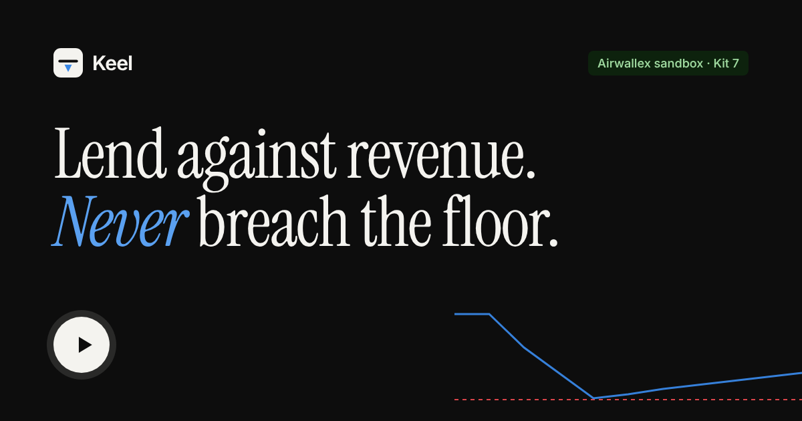](DEMO_VIDEO_URL)

- **Demo video** (under 5 minutes): DEMO_VIDEO_URL
- **Live site:** LIVE_SITE_URL ([console](LIVE_SITE_URL/console), [sandbox run](LIVE_SITE_URL/run))
- **Evidence:** [`evidence/`](evidence), every Airwallex transfer, charge and `request_id` from a recorded sandbox run

Airwallex Agentic Banking Hackathon 2026 · **Kit 7: Portfolio Lending Agent (Dynamic Lending)**

## Contents

- [The problem](#the-problem)
- [What Keel does](#what-keel-does)
- [Try it in a minute](#try-it-in-a-minute)
- [How it works](#how-it-works)
- [Architecture](#architecture)
- [The decision engine](#the-decision-engine)
- [One transfer, never two](#one-transfer-never-two)
- [Underpayments, late money and old promises](#underpayments-late-money-and-old-promises)
- [What the model does, and what it never does](#what-the-model-does-and-what-it-never-does)
- [Guarantees](#guarantees)
- [The verified sandbox run](#the-verified-sandbox-run)
- [Screens](#screens)
- [Data model](#data-model)
- [Tech stack](#tech-stack)
- [Running it yourself](#running-it-yourself)
- [Testing](#testing)
- [Project layout](#project-layout)
- [Known limitations](#known-limitations)

## The problem

Revenue-based financing is a good fit for platforms. The platform already sees each merchant's sales, so it can advance cash against them and take repayment as a fixed share of each week's revenue. The hard part is the portfolio, not any single loan:

- **The reserve.** Every advance competes for the same cash. Say yes to everyone and one bad week leaves the platform unable to pay out what it already promised.
- **Health changes faster than credit decisions.** A merchant approved in week 1 can be in trouble by week 7.
- **Money is messy.** Customers pay late. Bank responses get lost. A retry that pays a merchant twice is a real loss.
- **Someone has to answer for every decision.** "The model said so" is not a credit memo.

## What Keel does

Every simulated week, for every borrower, Keel:

| Step | What happens | Airwallex |
| --- | --- | --- |
| **Observe** | Records the week's sales and what actually settled | Deposit simulation into each borrower's Global Account |
| **Collect** | Takes the revenue share of money that has landed. A gap becomes a receivable, never an overdraft | `charges/create` with `x-on-behalf-of` |
| **Review health** | Trend, volatility and sudden drops give each borrower a tier: healthy, watch or stressed. Stressed freezes new credit | — |
| **Fund promises** | Re-decides each pending advance against *today's* cash and *today's* borrower before paying | `connected_account_transfers/create` |
| **Decide requests** | Builds every way to answer (full, partial, delay, reallocate, decline), strikes anything that breaches the floor, scores the rest | `connected_account_transfers/create` |
| **Reconcile** | Checks its own ledger against the bank balance | `balances/current`, then `BALANCE_REPORT` at the end |

The three outcomes a borrower can get:

| Outcome | When |
| --- | --- |
| **Funded** (in full, partially, or later) | The borrower has capacity and the floor holds after paying |
| **Funded by reallocation** | Paying in full would breach the floor, so Keel shrinks a weaker borrower's *unpaid* promise. This always needs a human approval |
| **Declined or withdrawn** | The borrower is stressed, or out of capacity. A stale promise becomes a fresh no |

## Try it in a minute

1. Open the **live site** and press **Run the ten weeks**.
2. The console plays ten weeks. Pause at week 5: the third advance doesn't fit under the floor, and Keel asks you to approve a reallocation. Approve it, or reject it and see what happens instead.
3. Click any numbered marker on the chart to open that decision, with every option it considered and the one it struck.
4. Drag **What if… → Nimbus revenue shock** to −85% or the **Reserve floor** to $50K. The engine re-runs in your browser.
5. Open **Sandbox run** to see the same ten weeks on the Airwallex sandbox, with every transfer id and `request_id` the API returned.

No account and no install needed. The console runs the real engine (the same TypeScript the tests cover) in your browser against an in-memory bank.

## How it works

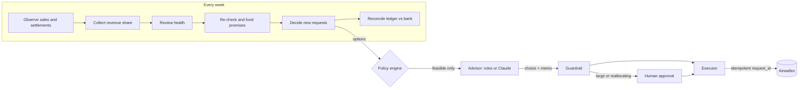

## Architecture

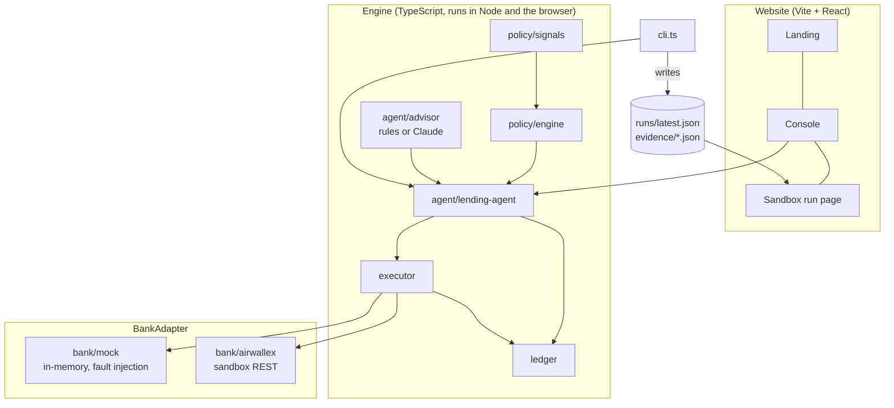

- **One engine, two banks.** The agent only sees a `BankAdapter`. The website and the tests use the in-memory `MockBank`, which can lose responses on purpose. `npm run demo:sandbox` swaps in `AirwallexBank` and nothing else changes.
- **Ring-fenced fund.** The sandbox wallet holds millions, so a $30K floor would never bind. The CLI ring-fences the fund: Keel may lend only $100K of the wallet, and the floor is measured inside it.
- **Money is integer cents** everywhere inside Keel. Conversion to Airwallex's major units happens in one place, at the adapter boundary.

## The decision engine

For every request, `buildOptions` (`src/policy/engine.ts`) enumerates the possible answers and scores each with fixed rules:

| Option | Amount | Feasible when |
| --- | --- | --- |
| Full | `min(request, capacity)` | Cash after paying, minus every other promise, stays ≥ floor |
| Partial | The most free capital allows | ≥ $2,000 minimum advance |
| Delay | Full amount, 1–4 weeks later | Projected collections (haircut 20%) close the gap |
| Reallocate | Full amount now | Weakest borrowers' *unpaid* commitments cover the gap. Never money already paid out |
| Decline | $0 | Always |

**Capacity** is `avg weekly revenue × 4 weeks × tier multiplier` (healthy 1.0, watch 0.6, stressed 0), capped at 35% of the fund, minus what the borrower already owes or has been promised.

**Score** is `expected fee − expected loss − friction`, where loss depends on tier (2% / 8% / 30%), delay costs 1.5% a week, and reallocation charges the forgone fee and a relationship cost, offset by the risk it removes.

In the canonical run, Nimbus asks for $26,000 in week 5. Paying in full would leave $26,284, under the $30,000 floor:

| Option | Score | Cash after | |
| --- | --- | --- | --- |
| Full $26,000 | $1,560 | $26,284 | ✗ breaches floor |
| Reallocate $26,000 | $1,523 | $30,000 | **chosen**, approved by a human |
| Partial $22,200 | $1,332 | $30,084 | |
| Delay to week 9 | $0 | $31,187 | |
| Decline | $0 | $52,284 | |

## One transfer, never two

Every money movement has a deterministic idempotency key (`collect:adv_1:w6`, `disburse:req:req_3`). Against Airwallex it becomes the `request_id`: a UUID derived from `sha256(runId:key)`, so a retry sends the same `request_id` and a new run never collides with an old one inside Airwallex's 7-day dedupe window.

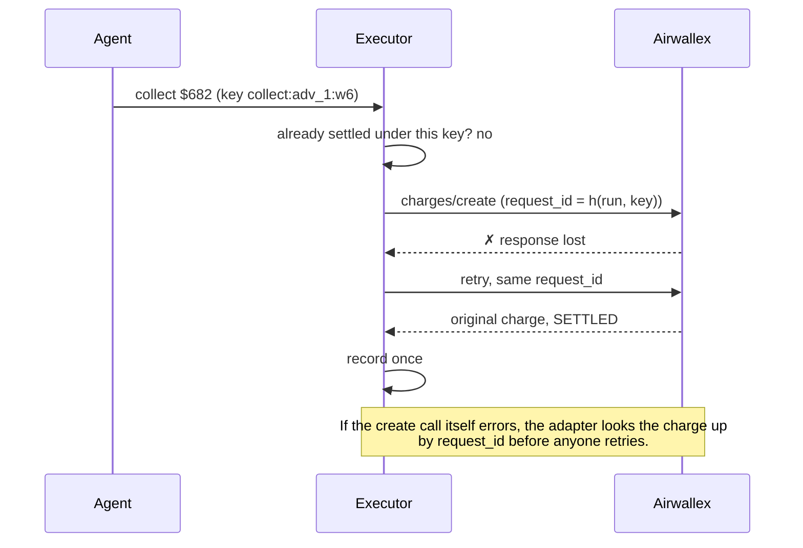

The executor also re-checks the reserve floor against the **live balance** before every disbursement, and only records a movement once the bank confirms it settled. In the demo, week 6's lost response is injected on purpose and shows up on the chart as an incident.

## Underpayments, late money and old promises

Kit 7 asks the agent to handle underpayment and reallocation, not just approvals. Keel separates three things that look alike on a bank statement:

| Situation | What Keel sees | What it does |
| --- | --- | --- |
| **Customer paid late** | Sales on trend, settlement short | Collects its share of what arrived, books the rest as a `late-payment` receivable, **keeps the tier**. Catches up the week the money lands |
| **Wallet can't cover the charge** | Charge would overdraw | Never sends it. Collects what is there, books a `wallet-short` receivable, retries weekly |
| **Business in trouble** | Sales down 35%+ in a week, or trend −25% | Tier → stressed. Freezes new credit, withdraws unpaid promises, keeps collecting a share of whatever revenue remains |

In the canonical run, Ledgerly's enterprise customers pay 60% of week 6 late. Keel collects on the 40% that settled, books a $520 receivable, and clears it in week 7. The same week, Kopi's $4,284 top-up comes due. It was promised when Kopi was healthy, but Kopi is now on watch and at capacity. Keel re-runs the decision before paying, and **withdraws** it.

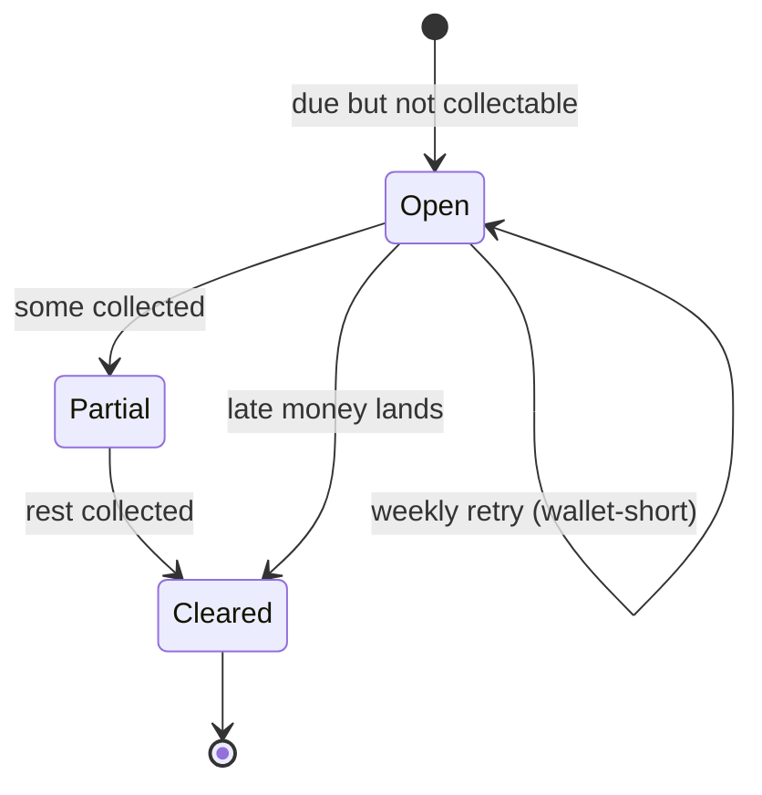

## What the model does, and what it never does

| The model may | The model may not |
| --- | --- |
| Choose among the options the policy marked feasible | Invent an option, an amount, or a week |
| Write the credit memo a human reviews | Pick an option that breaches the floor (the guardrail falls back to the best feasible one) |
| Weigh qualitative context in the portfolio summary | Call the bank. Only the executor can |
| Fall back to rules if it is unavailable | Skip approval for a large advance or any reallocation |

`npm run demo:llm` uses Claude through structured JSON output, so the reply must be one of the feasible `kind`s plus a memo. Without `ANTHROPIC_API_KEY` the deterministic `RulesAdvisor` takes over and the run is identical except for memo wording. A test runs the whole scenario with a rogue advisor that always says "full", and the floor still holds.

## Guarantees

| Guarantee | How it is checked |
| --- | --- |
| No approved option ever leaves cash below the floor | Property test over **2,000 random portfolios** (`test/policy.test.ts`) |
| Every money movement happens once | Lost-response and lost-create tests against the mock and a fake Airwallex server |
| The ledger matches the bank every week | `reconcile()` compares against the bank balance; the end-to-end test asserts it for all 10 weeks |
| Late money is not read as distress | Scenario test: Ledgerly stays healthy and its receivable clears in week 7 |
| Promises are re-checked before payment | Scenario test: Kopi's pending advance is withdrawn in week 6 |
| The model can't override policy | Rogue-advisor test |
| Advances over $20K and all reallocations need a human | Approval gate in `LendingAgent.choose`; the console shows the dialog |

## The verified sandbox run

`npm run demo:sandbox` runs the same ten weeks against the Airwallex sandbox:

- three borrowers as **active connected accounts**, each with a USD **Global Account** (`npm run sandbox:setup`)
- revenue staged with **deposit simulations**
- advances out with **`connected_account_transfers/create`**, repayments in with **`charges/create`**, both polled from `NEW` to `SETTLED`
- a **`BALANCE_REPORT`** requested at the end, the bank's own snapshot of the portfolio

The run is written to `web/public/runs/latest.json` (shown at [`/run`](LIVE_SITE_URL/run)) and copied into [`evidence/`](evidence). Every id in those files is one Airwallex returned and can be searched in the sandbox dashboard.

Result of the recorded run: floor held every week, ledger reconciled every week.

## Screens

| | |
| --- | --- |
| 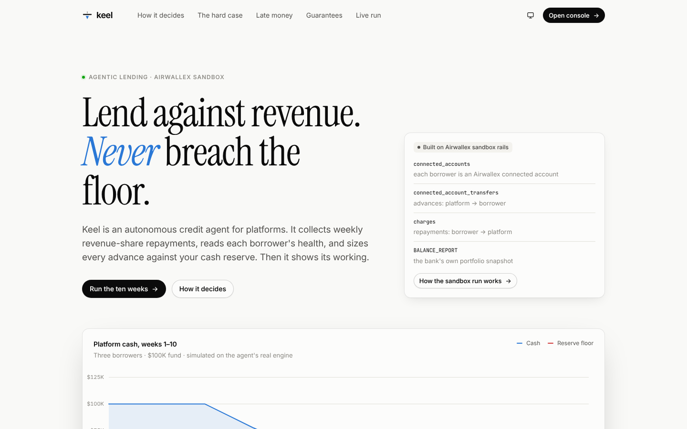 | 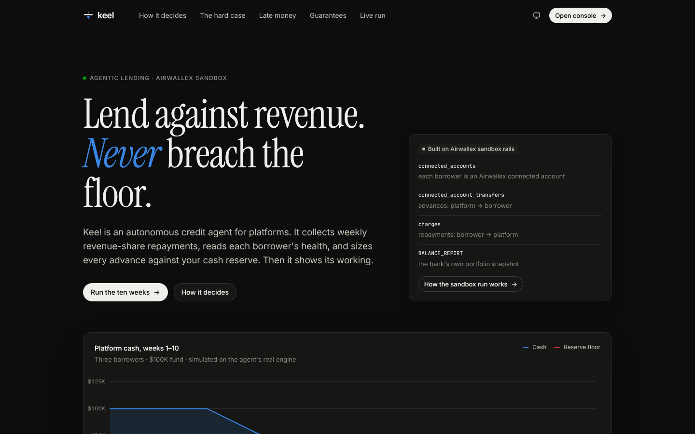 |
| 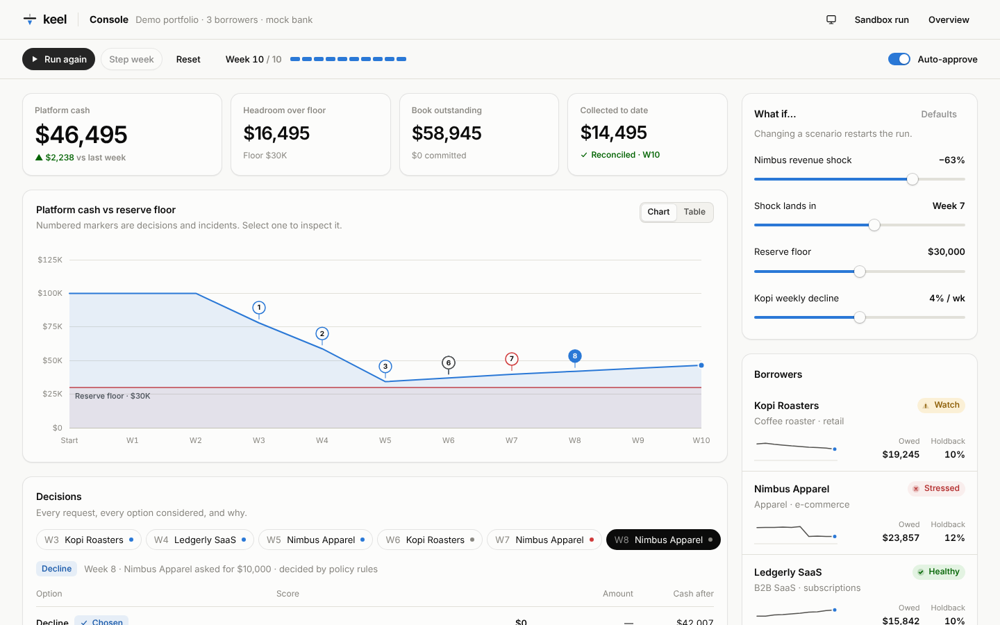 | 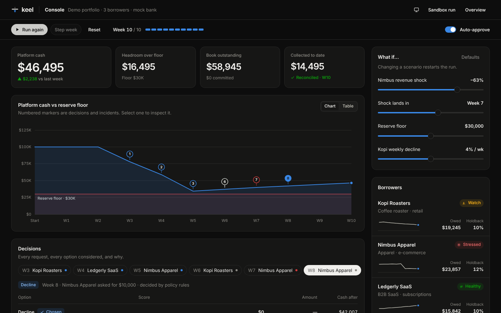 |
| 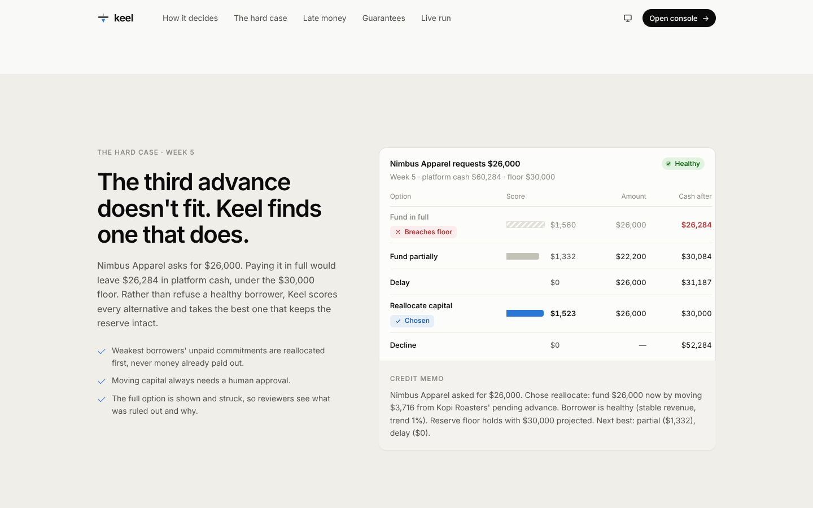 | 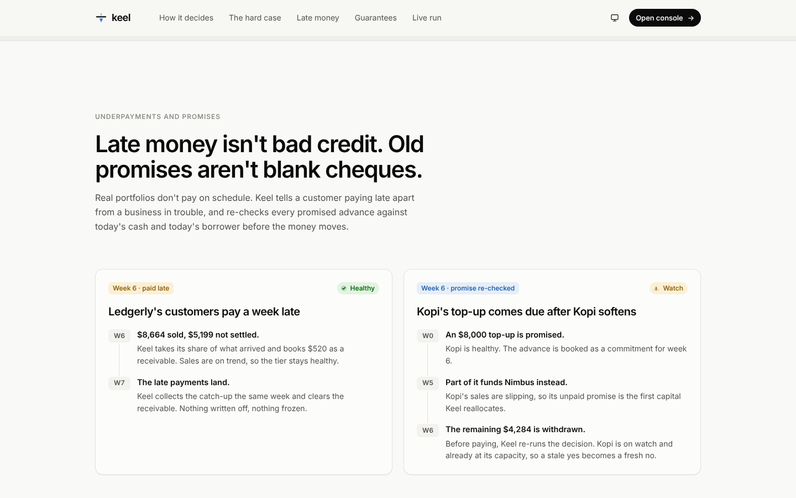 |
| 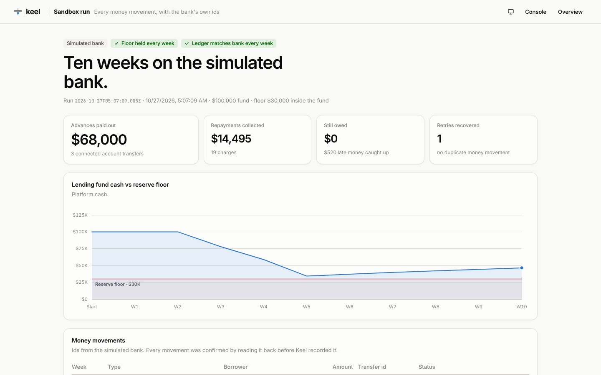 | 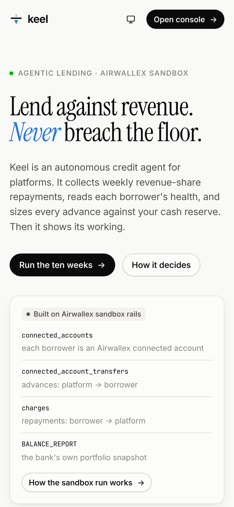 |

## Data model

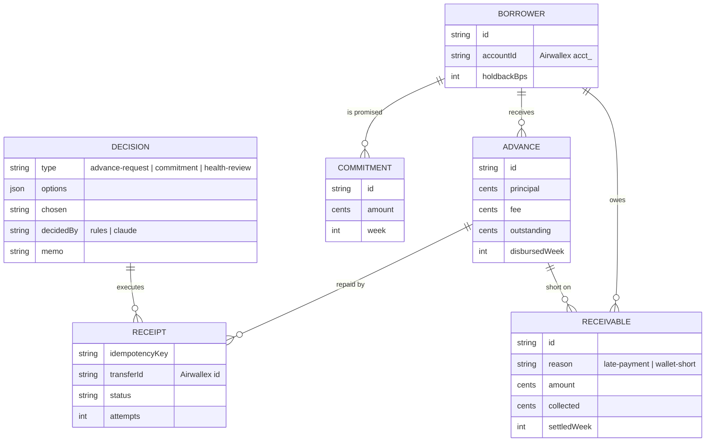

## Tech stack

| Layer | Choice |
| --- | --- |
| Engine | TypeScript (strict, `noUncheckedIndexedAccess`), no runtime dependencies beyond the Anthropic SDK |
| Bank | Airwallex sandbox REST API: connected accounts, Global Accounts, transfers, charges, deposit simulation, platform reports |
| Model | Claude via `@anthropic-ai/sdk`, structured output, rules fallback |
| Website | Vite, React 19, React Router, hand-written SVG charts, Inter / Instrument Serif / JetBrains Mono |
| Tests | Vitest, fast-check |
| Hosting | Vercel (static) |

## Running it yourself

Needs Node 20.12+ (`.nvmrc` pins 22).

```bash
npm install
npm run dev          # website at http://localhost:5173
npm test             # 23 tests, including the 2,000-portfolio property test
npm run demo         # the ten weeks in the terminal, simulated bank
```

### Commands

| Command | What it does |
| --- | --- |
| `npm run dev` | Website with hot reload |
| `npm run build` / `npm run preview` | Production build into `dist/web`, served at :4173 |
| `npm run typecheck` | Engine and website |
| `npm test` | All tests |
| `npm run demo` | Simulated run in the terminal; add `-- --record` to save it for `/run` |
| `npm run demo:llm` | Same, with Claude choosing and writing memos |
| `npm run sandbox:check` | Logs in to Airwallex, lists Global Accounts, balances and borrowers |
| `npm run sandbox:setup` | Creates the three borrowers as active connected accounts with USD Global Accounts |
| `npm run demo:sandbox` | The ten weeks on the Airwallex sandbox; writes `runs/latest.json` and `evidence/` |

### Environment

Copy `.env.example` to `.env`. Only the sandbox and Claude modes need it.

| Variable | Needed for | |
| --- | --- | --- |
| `AIRWALLEX_CLIENT_ID`, `AIRWALLEX_API_KEY` | sandbox | Account → Developer → API keys |
| `AIRWALLEX_BORROWER_ACCOUNTS` | sandbox | Printed by `sandbox:setup`: `kopi=acct_…,nimbus=acct_…,ledgerly=acct_…` |
| `AIRWALLEX_GLOBAL_ACCOUNTS` | sandbox, optional | Skips the Global Account lookup |
| `AIRWALLEX_BASE_URL` | optional | Defaults to `https://api.sandbox.airwallex.com` |
| `ANTHROPIC_API_KEY` | `demo:llm` | |

### Connecting the Airwallex sandbox

1. Sign up at [sandbox.airwallex.com](https://sandbox.airwallex.com) and create an API key.
2. Kit 7 needs **connected accounts and platform payments** enabled on the sandbox account. Ask Airwallex developer support with your sandbox email and Client ID.
3. `npm run sandbox:check`, then `npm run sandbox:setup`, then paste the printed lines into `.env`.
4. `npm run demo:sandbox`. Commit `web/public/runs/latest.json` and the new `evidence/` file to publish the run.

### Deploying

The site is static. `vercel.json` sets the build (`npm run build` → `dist/web`) and rewrites every route to the app, so `/console` and `/run` load directly. Import the repo in Vercel and deploy; no environment variables are needed. The live run shown at `/run` is whichever `web/public/runs/latest.json` is committed.

## Testing

| File | Covers | Tests |
| --- | --- | --- |
| `test/policy.test.ts` | Floor invariant over 2,000 random portfolios, repayment caps, capacity, health signals | 6 |
| `test/executor.test.ts` | Lost response retried once, replay is a no-op, floor checked before the bank is called | 3 |
| `test/collections.test.ts` | Wallet-short receivables, late payment and catch-up, promise re-check | 3 |
| `test/scenario.test.ts` | The canonical ten weeks end to end, rogue advisor, late money, withdrawn promise | 5 |
| `test/airwallex.test.ts` | The adapter against a fake Airwallex server: units, headers, polling, lost creates, `BALANCE_REPORT` | 6 |

CI runs typecheck, tests, the production build and a simulated ten-week run on every push.

## Project layout

```
src/
  domain.ts              money, borrowers, advances, options
  policy/signals.ts      revenue → health tier
  policy/engine.ts       options, capacity, scoring, floor invariant
  agent/lending-agent.ts the weekly loop
  agent/advisor.ts       rules advisor (and the Advisor interface)
  agent/claude-advisor.ts
  executor.ts            the only code that moves money
  ledger.ts              book, receivables, decision log
  bank/                  BankAdapter, MockBank, AirwallexBank
  sandbox/               check, setup, request bodies
  sim/                   scenario, runner, run record
  cli.ts
web/                     the website (landing, console, sandbox run)
test/
evidence/                recorded Airwallex sandbox runs
docs/                    screenshots, video storyboard, submission text
```

## Known limitations

- **Simulated revenue.** Sales are generated by the scenario and staged as deposit simulations. A production version would read real settlements from the platform.
- **Weekly, not continuous.** Keel decides on a weekly clock. Real-time collection would hang off Airwallex webhooks.
- **One currency.** USD only. The adapter takes a currency, but FX between borrower and platform is not modelled.
- **Static evidence.** The hosted site shows a recorded sandbox run; it does not call Airwallex from the browser, because that would need API keys in the client.
- **Policy is hand-tuned.** Tier thresholds, loss rates and the capacity multiple are sensible defaults for a demo, not a calibrated credit model.
- **Not a lending offer.** A hackathon project, not affiliated with or endorsed by Airwallex.
